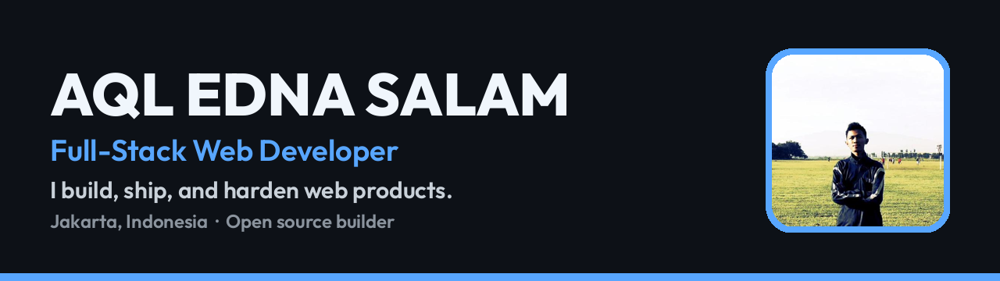

## About

I'm a full-stack web developer based in **Jakarta, Indonesia**, building on the web since early 20s. I don't just build demos — I design, build, secure, deploy, and maintain real products that are live on the internet right now, under my own domains, with real users in mind.

My work sits at the intersection of three things:

- **Product engineering** — complete web apps taken from an empty repo to a deployed, verified production release
- **Privacy & security engineering** — end-to-end encryption, row-level security, server-side secrets, rate limiting, and security audits of my own systems before they ship
- **Open source tooling** — small, zero-dependency libraries published properly: versioned, tested, documented, and released on npm and CDN

> Vanilla when vanilla is enough. A framework when the problem actually needs one.

*And yes — I read the error message. The whole thing, not just the red part.*

---

## What I do

| Area | What that means in practice |
| --- | --- |
| **Build products** | End-to-end ownership: architecture, UI, data model, auth, deployment, monitoring, iteration after launch |
| **Build libraries** | Zero-dependency JavaScript tooling with ESM + UMD builds, smoke tests, semantic releases, and npm/CDN distribution |
| **Secure systems** | Threat-aware defaults: encryption in the browser, secrets kept server-side, database policies pinned to owners, origin checks, and honest security documentation |
| **Audit & harden** | Systematic security and accessibility audits — findings fixed, merged, and verified live, not left as a report |

---

## Featured work

### [Bisik](https://github.com/aqles/bisik) — encrypted chat that stores nothing

End-to-end encrypted two-person chat. No accounts, no database — messages are never stored, anywhere. Hard to leak a table that doesn't exist.

- Room keys derived with **PBKDF2 (250k iterations)** → **AES-GCM-256** encryption entirely in the browser via Web Crypto API
- WebSocket relay that lives only in RAM: max 2 people per room, a message to an offline peer is dropped, never queued
- Server hardening included from the start: per-socket rate limits, connection caps, origin allowlist, full security headers (CSP, frame denial, nosniff)
- WhatsApp-style delivery receipts (✓ sent · ✓✓ delivered · ✕ gone) without the server ever seeing message content
- Released under **AGPL-3.0** so hosted modifications have to stay open

**Live:** [bisik.ednasalam.com](https://bisik.ednasalam.com) · **Stack:** Node.js · WebSocket · Web Crypto API · PWA

### [ScrollFlow](https://github.com/aqles/scrollflow) — scroll animation library, published on npm

A lightweight, zero-dependency JavaScript library for reveal-on-scroll, parallax, and reading progress — because nobody should install 200 kB of dependencies to fade in a heading.

- **2.4 kB gzipped total**, no dependencies, ships as ESM + UMD + minified builds
- Correct parallax (relative to element centre, not page top), any-millisecond delays, `refresh()` / `destroy()` API
- Respects `prefers-reduced-motion`, and content stays visible even if JavaScript fails
- Smoke-tested, CI-green, distributed via **npm (`@aqles/scrollflow`)**, jsDelivr CDN, and GitHub Releases

**Live demo:** [aqles.github.io/scrollflow](https://aqles.github.io/scrollflow/) · **Stack:** Vanilla JavaScript · CSS · IntersectionObserver

### [PintarCilik](https://github.com/aqles/PintarCilik) — learning game for kids aged 4–6

Reading, counting, and logic games for young children — designed to be safe, installable, and usable by parents.

- **React + TypeScript + Supabase** with Google sign-in and row-level security: every child profile and result is visible only to its owner
- 10+ game modes plus read-aloud stories using browser text-to-speech — no paid AI/TTS service in the loop
- Installable **PWA**, accessibility toggles, parent gate, and achievement badges

**Live:** [calistung.ednasalam.com](https://calistung.ednasalam.com) · **Stack:** React · TypeScript · Supabase · Tailwind CSS · Vite

### [Baz-On](https://github.com/aqles/baz-on) — offline-first static e-commerce

A complete storefront with no backend and no build step.

- Catalogue, variants, wishlist, coupons, and WhatsApp checkout in **vanilla JavaScript**
- **Service Worker** offline support — the full catalogue keeps working with the connection cut
- Flat, single-accent design system; localised assets (no runtime dependency on avatar/CDN services)

**Live:** [aqles.github.io/baz-on](https://aqles.github.io/baz-on) · **Stack:** Vanilla JavaScript · PWA · Service Workers

### ednasalam.com — my portfolio, run like a product

My main site is itself a production system: a Supabase-backed project ledger and blog, a working terminal interface, and an AI assistant whose API key lives **server-side only** after a security audit found the original client-side exposure — fixed, merged, and verified live. Database policies for blog, storage, projects, and settings are pinned to a single admin identity.

**Live:** [ednasalam.com](https://www.ednasalam.com) · **Stack:** React · TypeScript · Supabase (RLS) · Vercel Serverless

---

## How I work

1. **Ship, then verify live.** A change isn't done when it merges — it's done when the production site proves it.
2. **Security is a default, not a phase.** RLS on every table, secrets on the server, rate limits and origin checks on public endpoints.
3. **Small and dependency-light.** Every dependency is a maintenance and supply-chain cost; I add them on evidence, not habit.
4. **Honest documentation.** READMEs and security pages say what a system does *and* what it doesn't do yet — including the limitations.
5. **Licences are a decision.** MIT for libraries that should spread, AGPL for products that should stay open. Chosen deliberately, per project.
6. **I don't deploy on Friday.** Not superstition — I just like my weekends the way they are.

---

## Tech stack

**Languages**

**Frontend**

**Backend & data**

**Tools & infrastructure**

---

## GitHub analytics

---

## Currently

- Maintaining **Bisik** (AGPL) and **ScrollFlow** (npm) as public open source
- Building learning software with **PintarCilik**
- Writing about security findings and shipping notes on [ednasalam.com](https://www.ednasalam.com)
- Closing browser tabs. Eventually.

## Connect

The fastest way to see my work is to open it — every project above is live. For anything else, reach me through [ednasalam.com](https://www.ednasalam.com), [Instagram](https://instagram.com/aql_es), or [X](https://x.com/aqles).

Found a bug in one of my projects? It's not a feature, I promise — open an issue and I'll fix it.
